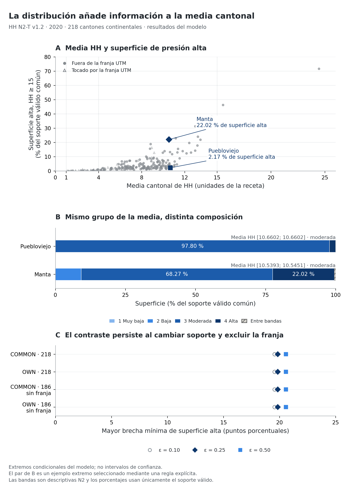

# IndiGeo HH N2

**Reproducible cantonal summaries of Ecuador's Human Footprint, 2014–2022.**

Aggregate results for **218 continental cantons**, five reference years and a reproducible analysis of what within-canton surface distributions add to a cantonal mean. This accompanies the descriptive HH N2-T v1.2 reconstruction. It is research software and data, not an official MAATE product or an independently validated map of temporal change.

**En español:** tablas y figuras de HH para los 218 cantones continentales, con código para regenerar el análisis de medias y distribuciones desde tablas congeladas. No incluye Galápagos ni BR.

## Start here

| Task | File |
| --- | --- |
| Understand the results and limits | [Results](docs/RESULTS.md) |
| Explore levels, modeled differences and benchmark summaries | [Product tables](products/tables/) |
| View F3–F6 | [Figure gallery and captions](products/README.md) |
| Inspect all 2,180 canton–year–support rows | [Joined analysis table](expected/analysis/cantons_joined.csv) |
| Understand fields, units and denominators | [Data dictionary](DATA_DICTIONARY.md) |
| Trace the inputs and permissions | [Sources and rights](docs/SOURCES_AND_RIGHTS.md) |

## Why both means and distributions?

Two cantons can have close modeled HH means but different proportions of high-pressure surface. In the explicitly selected 2020 example, Puebloviejo and Manta have means near 10.66 and 10.54, while their high-pressure shares are 2.17% and 22.02%. This is an algorithmically selected extreme, not a representative pair. All qualifying pairs and sensitivity contexts are supplied.



The bands [0,1), [1,4), [4,15), [15,∞) are descriptive N2 adaptations, not official MAATE classes or calibrated ecological thresholds. See the [fixed specification](ANALYSIS_SPEC.md) and [method clarification](METHOD_CLARIFICATION.md).

## Reproduce from a clean checkout

Tested: **CPython 3.13.0, macOS arm64**, with exact versions in `requirements.txt`. Use a new virtual environment without system/user site-packages.

```sh
git clone https://github.com/andresalmeida/indigeo-hh-n2.git
cd indigeo-hh-n2
python3 -B verify_release.py
python3.13 -m venv .venv
.venv/bin/python -m pip install -r requirements.txt
.venv/bin/python -I -B reproduce.py --out build-national
```

`build-national` must not already exist. Installation needs internet access; analysis/rendering uses only the supplied tables and requires no credentials. On the tested macOS arm64/CPython 3.13 platform, replace the installation line with the wheel-hash lock if desired:

```sh
.venv/bin/python -m pip install --require-hashes -r requirements-macos-arm64.lock.txt
```

That lock is platform-specific. Windows/Linux portability is not established by this test; the Windows executable path would be `.venv\Scripts\python.exe`.

The command checks input/code hashes, regenerates six complete CSVs, compares them byte for byte with `expected/analysis/`, verifies the analytical JSON and figure bindings, exports F7 as PNG/SVG/PDF, and writes `build-national/REPRODUCTION_RESULT.json`.

The archived clean-environment run reproduced **2,180 rows, 60 sensitivity contexts and all figure bindings**. Its PNG matched pixel for pixel. SVG/PDF binary equality is not required because export metadata/identifiers may differ. See the [test report](docs/REPRODUCTION_TEST.md) and [receipt](docs/reproduction_receipt.json).

**Boundary:** this starts from seven frozen aggregate CSVs. It does not regenerate HH rasters from primary inputs, run the national solver, query Earth Engine, recreate F3–F6 or repeat the private parcel benchmark. F3–F6 and their public aggregate tables are archived products; F7 is regenerated by the command.

## Interpretation and limits

- OWN uses each year's valid support; COMMON uses the intersection across all five cuts. Cross-year modeled differences use common support.
- Scenario endpoints and guaranteed/possible membership are conditional model bounds, not confidence intervals, probabilities or total uncertainty.
- VIIRS changes version in 2020–2022. The UTM grid-crossing control remains unresolved; exclusion sensitivity is not a repair.
- The historical visual-proxy benchmark measures rank association in its sample, not national accuracy, equivalence or superiority. N2 was reconciled with SDG15; the maps are not independent predictions.
- Cross-year differences are modeled outputs, not observed ecological change. Independent temporal validation remains incomplete.
- Aragón/SDG15 already provides a 30 m biennial series for 2014–2022; temporal coverage and pixel spacing are not N2 innovations. See the [contribution statement](docs/PAPER_CONTRIBUTION_EN.md).

## License, attribution and citation

Original Python code is licensed under [MIT](LICENSE). **MIT does not automatically cover the input/output data, figures, documentation or upstream material.** Their separate status is described in [Sources and rights](docs/SOURCES_AND_RIGHTS.md). No blanket data license is assigned in this initial upload.

For reproducibility, cite **IndiGeo HH N2**, this repository URL and the exact commit used. Acknowledge the upstream work, including [Aragón-Osejo et al., National human footprint maps for Peru and Ecuador](https://doi.org/10.1038/s41597-025-06301-0). A finalized scholarly author list, tagged release and Zenodo DOI are not supplied by this initial upload. No DOI has been assigned.

Report reproducibility problems through repository issues, including OS, Python version and the reproduction report. Do not upload credentials or private reference data.
