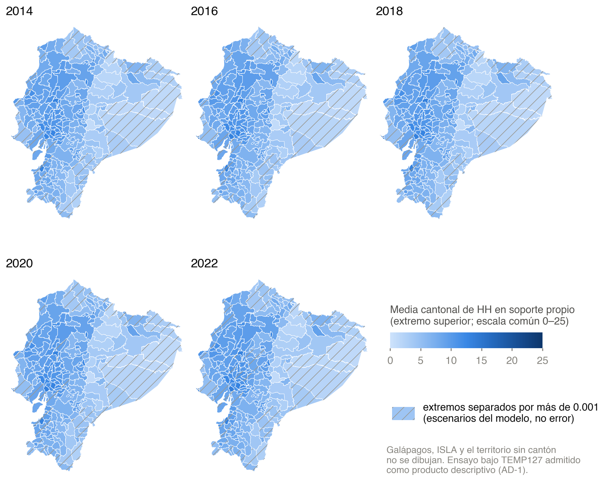
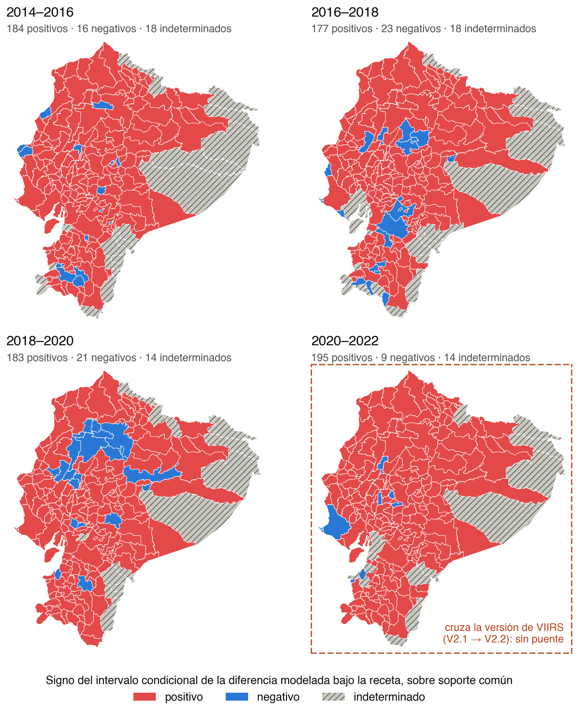
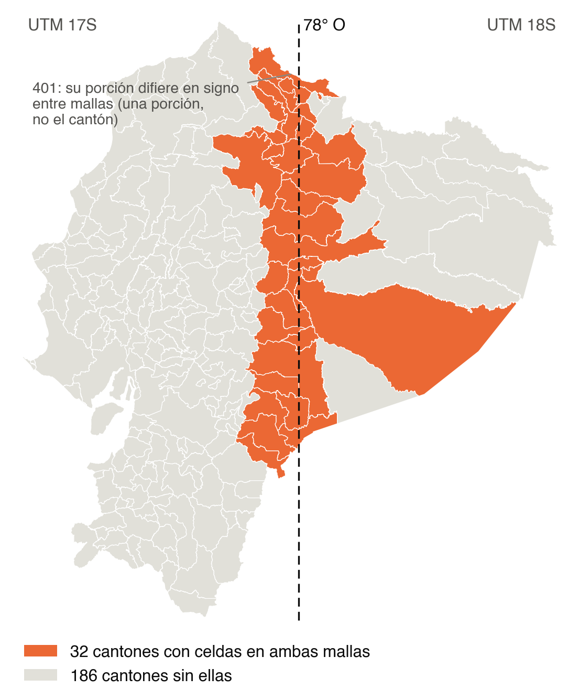
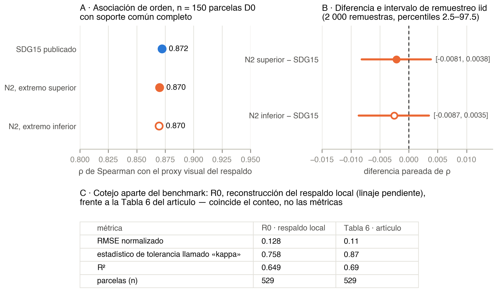

# Archived figures and aggregate tables

These PNGs and tables are byte-identical copies of the archived descriptive product. Copy hashes are in [source_manifest.json](source_manifest.json). The root command regenerates F7, not these maps or the private benchmark.

The [original Spanish captions](captions_es.md) give the complete reading rules. Internal identifiers such as AD-1, U1 and TEMP987 refer to archived decisions/diagnostics, not extra runtime files.

## F3 — levels on annual valid support

Common scale, 0–25. Hatching marks endpoint separation, not statistical error. OWN supports vary: do not subtract these means across cuts. [Levels](tables/levels.csv).

## F4 — signs of modeled differences on common support

Positive/negative place the whole conditional model interval on one side of zero; indeterminate includes zero. These are not tests of significance, observed changes or intensity categories. The 2020–2022 interval crosses VIIRS versions without a bridge. [Differences](tables/differences.csv).

## F5 — UTM strip

32 of 218 cantons are affected. Sensitivities do not approve or repair the grid crossing. Canton 401's annotation concerns a portion, not the entire canton. [UTM table](tables/utm.csv).

## F6 — rank association and separate R0 comparison

Similar association in 150 complete D0 parcels is not equivalence or accuracy; paired resampling intervals include zero. Matching the count 529 does not prove the same parcel identities; Table 6 metrics remain unreproduced. [Tables](tables/) and [results](../docs/RESULTS.md).
